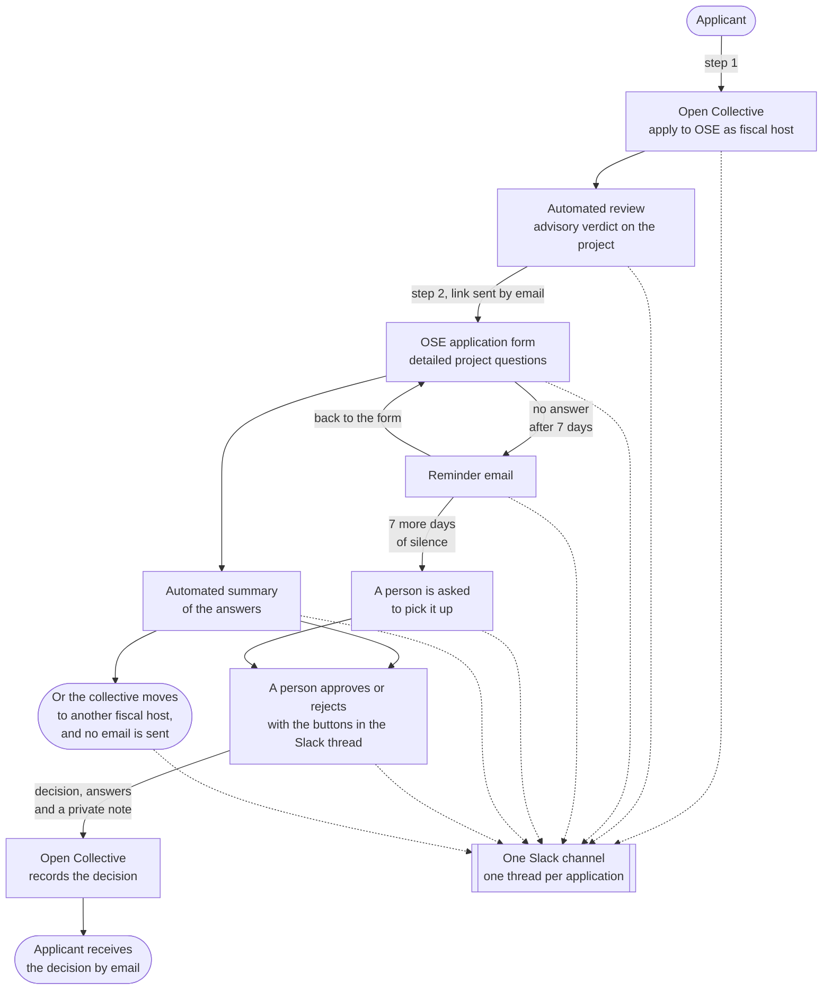

All things community for [Open Source Europe (OSE)](https://opensourceeurope.org/).

## About

Open Source Europe is a European nonprofit that gives open source projects a shared fiscal and legal structure. No project needs to set up its own legal entity. OSE provides a common nonprofit structure, so maintainers can receive donations, manage expenses, and operate transparently. Each project stays fully autonomous.

This repository holds community discussions, governance, processes, and shared resources for projects that OSE hosts.

## How an application works

An application passes through two forms. Open Collective hosts the first one,
Open Source Europe hosts the second, and the steps in between are automated.

The following diagram shows the whole process and what each system does in it:

An application starts and ends on Open Collective. Open Collective calls OSE a
fiscal host, and a Collective applies to a host from that host's page. Once the
form is in, a person approves or rejects with the Approve and Reject buttons in
the application's Slack thread. They can edit the email the applicant will get
and add a note for OSE's admins, and they confirm both before anything is sent.
Their confirmation records the decision on that same application on Open
Collective. It also stores the applicant's form answers with the decision, where
only OSE's admins and the Collective's own admins can read them. It adds the
note, which only OSE's admins see. Open Collective holds the decision, and no
automated step makes it, according to the
[AI policy](https://github.com/opensourceeurope/.github/blob/main/AI-POLICY.md).
The applicant then receives an email with the outcome. A Collective that moves
to another fiscal host instead ends the application without one, because OSE
decided nothing.

The OSE application form is step 2. An application on Open Collective carries
the Collective's description, its links, and a short message. The form collects
the following details that OSE needs in addition:

- What the project does, and where its work happens in the open
- Which license the project uses
- Whether the project is already a legal entity
- How much money the project expects to raise and to spend

The license must be approved by the Open Source Initiative (OSI). For data and
content, the Open Definition must approve it instead.

The link to the form arrives by email after step 1. An applicant who has not
applied on Open Collective cannot get past the first page of the form.

The automation connects the two forms. It picks up each new application and
emails the invitation to the form. After seven days of silence it sends one
reminder. After seven more days it asks in the Slack thread for a person to pick
the application up. When that person rejects an application whose form never came
back, the email tells the applicant it was closed for lack of a response.

A model hosted in the European Union reads each application twice, and each read
returns a verdict rather than a description. The first read covers the public
project material and gives a verdict with its reasoning. The possible verdicts
are: the project fits, it belongs with another host, it is not open source, or
the evidence is unclear. The verdict sets which invitation email the applicant
receives, and the review itself goes into the Slack thread. The second read runs
after a submission. It reads the answers and the project's README, then posts
one paragraph and a verdict of its own.

Both reads are advisory. Neither one recommends an approval or a rejection, and
a person makes the decision. The workflows run on
[n8n](https://n8n.io), self-hosted on a European virtual server.

Every update about every application appears in one Slack channel. The first
message about an application starts a thread. Every later step replies in that
thread: the review, the invitation, the reminder, the escalation, the
answers, the summary, the Approve and Reject buttons, who decided, and the
outcome. Reactions on the first message show the current
stage. To follow one application, read its thread. To see all of them, read the
channel.

[`automation/`](automation/) holds the workflows that run this, the email
templates they send, and the operator runbook.

## License

This repository carries two licenses:

- Everything except `automation/` is licensed under [CC-BY-4.0](LICENSE).
  This content includes governance, process, and other documents.
- Everything under [`automation/`](automation/) is software and is licensed
  under the [MIT License](automation/LICENSE).

This repository accepts contributions under the license that covers the path
they touch.
